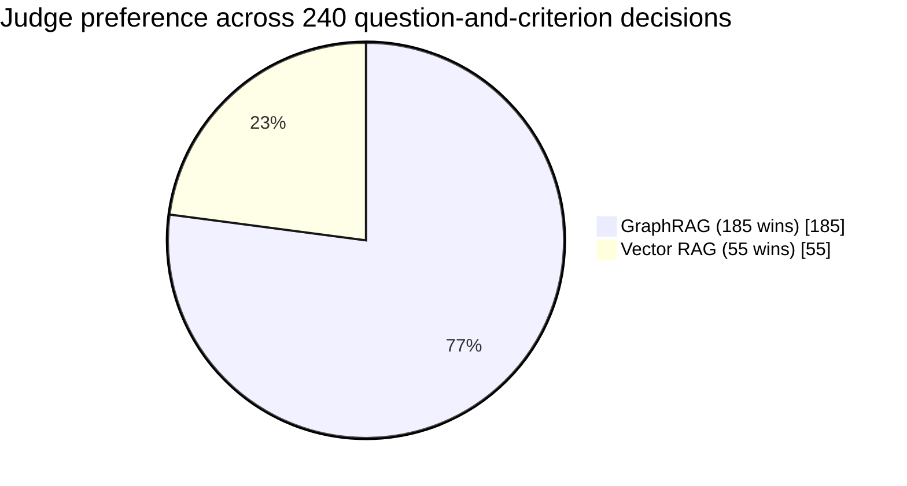

## Rousseau: VectorRAG vs. GraphRAG
The purpose of this project is to explore Microsoft's GraphRAG and VectorRAG ability to answer
questions on Jean-Jacques Rousseau's political/philosophical corpus.

## Thesis
**How do these two systems compare when answering questions about themes and ideas that span multiple documents?**

Rousseau's writings was chosen because his corpus contains multiple works that has the same overall theming/concept such
as freedom, rights, and government.
This project examines whether or not graph-based retrieval improves upon answer generation and also the 
trade-offs compared to VectorRAG.

**Takeaway:** In this 60-question benchmark, the LLM judge preferred GraphRAG in **77.08% of question-and-criterion comparisons**. Vector RAG was preferred for **directness** and answered much faster: **5.42 seconds** on average versus **656.38 seconds** for GraphRAG.

## Contribution

Microsoft's GraphRAG system is used to a select books by Rousseau. The data was chosen from an open source
site Project Gutenberg

- Collected and prepared the source texts for indexing.
- Configured GraphRAG's models, text chunking, and prompts.
- Implemented a VectorRAG baseline using Python, LangChain, and Chroma database.
- Developed a benchmark question set covering specific details and broader political/philosophical themes.
- Built scripts to generate answers, evaluate their quality, and analyze response times.
- Documented the strengths and limitations of each approach.

## Brief Overview of How the Two Systems Work

| Stage | VectorRAG | GraphRAG |
| --- | --- | --- |
| Preparation | Splits source texts into passages and embeds them. | Splits texts, extracts entities and relationships, and builds a graph and community reports. |
| Retrieval | Finds passages similar to the question using vector search. | Uses the configured search method to retrieve graph-related context and/or community reports. |
| Answer generation | Supplies retrieved passages to a language model. | Supplies the selected context to a language model. |

## Results

The benchmark contains 60 questions: 20 on local fact retrieval, 20 on cross-document reasoning, and 20 on global sensemaking. The judge, `gpt-4.1-mini`, compares answers on four criteria, with three judgments per question and criterion. Majority voting produces 240 decisions from 720 judgments.



| Criterion | GraphRAG wins | Vector RAG wins |
|---|---:|---:|
| Comprehensiveness | 100.00% (60/60) | 0.00% (0/60) |
| Diversity | 100.00% (60/60) | 0.00% (0/60) |
| Empowerment | 83.33% (50/60) | 16.67% (10/60) |
| Directness | 25.00% (15/60) | 75.00% (45/60) |
| **Overall** | **77.08% (185/240)** | **22.92% (55/240)** |

There were no ties or incomplete decisions. Overall percentages pool four criteria per question; they are not the percentage of questions answered correctly.

| Recorded response time | Vector RAG | GraphRAG |
|---|---:|---:|
| Mean | 5.42 s | 656.38 s (10.94 min) |
| Median | 5.05 s | 652.82 s (10.88 min) |

GraphRAG timing includes launching its CLI for each question. These are measurements from this run, not general performance guarantees.

**Interpretation:** The judge favored GraphRAG for breadth and detail, and vector RAG for directness. The judge compares the answers without checking their grounding against Rousseau's source passages, so these results do not establish factual accuracy or freedom from hallucination.

See the [machine-readable summary](benchmark/analysis_results/summary.json), [criterion results](benchmark/analysis_results/metric_summary.csv), and [latency results](benchmark/analysis_results/latency_summary.csv).


## Answer example

**Question L01:** What does Rousseau mean by the general will?

The following are opening excerpts from the saved answers, reproduced verbatim. They illustrate presentation style; they are not independently verified explanations of Rousseau.

| Vector RAG | GraphRAG — global search |
|---|---|
| Rousseau's concept of the **General Will** refers to the collective will of the citizens that aims at the common good and is both universal in its object and commonly held by the community. | Jean-Jacques Rousseau's concept of the *general will* is a foundational and central idea in his political philosophy, representing the collective sovereignty of the people as a unified body aimed at the common good and public interest. |
| **Recorded response time:** 16.867 s | **Recorded response time:** 705.086 s |

The full vector answer continues with a numbered explanation. The full GraphRAG answer expands into sections on sovereignty, liberty, institutions, and private interests, with internal report references. Read both complete responses in the [vector answer file](benchmark/vector_answers.json) and [GraphRAG answer file](benchmark/graphrag_answers.json); search for `L01`.


## Source Texts
Both GraphRAG and VectorRAG used these documents listed below. These were verified to be free domain. No copyrighted material was used.

Below list of sources used:

| Title | Translator | Source |
|---|---|---|
| *A Discourse Upon the Origin and the Foundation of the Inequality Among Mankind* | Unknown | [Project Gutenberg](https://www.gutenberg.org/ebooks/11136) |
| *The Social Contract & Discourses* | G. D. H. Cole (George Douglas Howard) | [Project Gutenberg](https://www.gutenberg.org/ebooks/46333) |
| *Emile* | Barbara Foxley | [Online Library of Liberty](https://oll.libertyfund.org/titles/rousseau-emile-or-education) |

## Explore the artifacts

| Artifact | What it contains |
|---|---|
| [Benchmark questions](benchmark/questions.json) | All 60 questions, categories, and intended scope |
| [Vector RAG answers](benchmark/vector_answers.json) | Generated responses and recorded latency |
| [GraphRAG answers](benchmark/graphrag_answers.json) | Global-search responses and recorded latency |
| [Raw judge evaluations](benchmark/evaluations.json) | Individual judgments used by the analysis |
| [Summary JSON](benchmark/analysis_results/summary.json) | Overall results, category breakdowns, latency, and methodological notes |
| [Question results](benchmark/analysis_results/question_results.csv) | Per-question, per-criterion majority outcomes |
| [Criterion summary](benchmark/analysis_results/metric_summary.csv) | Win rates by evaluation criterion |
| [Category summary](benchmark/analysis_results/category_summary.csv) | Results by question category |
| [Category and criterion summary](benchmark/analysis_results/category_metric_summary.csv) | Detailed breakdown across both dimensions |
| [Latency summary](benchmark/analysis_results/latency_summary.csv) | Mean and median response times |
| [Analysis script](benchmark/analysis.py) | Code that regenerates the summaries |


**Text preparation:**
All sources were used in a .txt format for these systems to embed. 
Before use, anything that was not written by Rousseau himself was removed which includes ie Introductions, Headers, Footers etc.

## Configuration

Record the settings used for the reported benchmark, including settings that differ between indexing and answering.

| Setting | VectorRAG | GraphRAG |
| --- | --- | --- |
| Framework and version | LangChain with langchain_openai, langchain_chroma, and langchain_text_splitters; Chroma vector database. Versions not recorded in the supplied files. | Microsoft GraphRAG v3.2.0 |
| Embedding model | text-embedding-3-large | text-embedding-3-large |
| Answer-generation model | gpt-4.1-mini with temperature=0 | gpt-4.1-mini |
| Indexing / extraction model | Not applicable unless used | gpt-4.1-mini for graph extraction, description summarization, and community report generation |
| Chunk size and unit | 500 characters, using RecursiveCharacterTextSplitter | 600 tokens, using the o200k_base encoding |
| Chunk overlap and unit | Configured overlap of 100 characters | 100 tokens |
| Retrieval settings | Chroma vector store at chroma_db, collection spinoza_collection. Uses similarity_search_with_score(k=5) to retrieve up to five passages. No score threshold or reranking is applied. | LanceDB vector store at output\lancedb. Local, global, DRIFT, and basic search are configured. The method used in the benchmark, community level, and query context limits are not specified in this file. |
| Answer instructions | PROMPT_TEMPLATE in rag_chain.py: base answers on retrieved excerpts, address the question directly, explain concepts clearly, connect ideas when supported, distinguish evidence from interpretation, and avoid unsupported claims or invented quotations and citations. Answer partially when evidence is incomplete; explicitly state insufficient information when no answer is supported. | Search-specific prompt files in prompts/, listed below. Their instructions and evidence rules require inspecting those files. |

See `settings.yaml` for further details.

## Repository Contents

| Path | Purpose |
| --- | --- |
| `RAG application/` | VectorRAG implementation, including ingestion and retrieval code. |
| `benchmark/` | Benchmark questions, answer-generation scripts, evaluation scripts, and small results files. |
| `prompts/` | Prompts used by the GraphRAG workflow. |
| `settings.yaml` | GraphRAG configuration. |
| `requirements.txt` | Python dependencies and versions needed to reproduce the project. |
| `.gitignore` | Excludes credentials, environments, and generated artifacts. |

Generated databases, caches, logs, and full indexing outputs are excluded. They can be recreated locally.

## Evaluation Method

**Question set**

The benchmark contains 60 questions that are evenly divided into three categories:

| Category | Questions | Purpose |
| --- | --- | --- |
| local_fact_retrieval | 20 | Retrieve specific definitions, concepts, or explanations from an individual work. |
| cross_document_reasoning | 20 | Connect and compare ideas across multiple works. |
| global_sensemaking | 20 | Synthesize broad themes and relationships across Rousseau’s writings. |


## Results

The benchmark evaluated 60 questions, with 20 questions in each of three categories. Each answer pair was evaluated by gpt-4.1-mini on four criteria, with three judgments per criterion. The 720 completed judgments were aggregated into 240 question–criterion majority decisions, with no ties or incomplete comparisons.


| Measure | VectorRAG | GraphRAG |
| --- | --- | --- |
| Questions successfully answered / attempted | 60/60 | 60/60 |
| Comprehensiveness win rate | 0% (0/60) | 100% (60/60) |
| Diversity win rate | 0% (0/60) | 100% (60/60) |
| Empowerment win rate | 16.67% (10/60) | 83.33% (50/60) |
| Directness win rate | 75% (45/60) | 25% (15/60) |
| Overall win rate across four criteria | 22.92% (55/240) | 77.08% (185/240) |
| Mean response time, seconds | 5.419 | 656.376 |
| Median response time, seconds | 5.054 | 652.816 |
| Source-support / faithfulness score | Not measured | Not measured |
| Indexing time, minutes | Not measured | Not measured |
| Total API cost, USD | Not measured | Not measured |


## Results by Question Category
| Measure | VectorRAG | GraphRAG |
| --- | --- | --- |
| Local fact retrieval | 23.75% (19/80) | 76.25% (61/80) |
| Cross-document reasoning | 21.25% (17/80) | 78.75% (63/80) |
| Global sensemaking | 23.75% (19/80) | 76.25% (61/80) |

**Interpretation**
GraphRAG was preferred on comprehensiveness, diversity, and empowerment, while VectorRAG was preferred on directness. However, its mean response time was approximately 10.94 minutes, compared with 5.42 seconds for VectorRAG—approximately 121 times longer in this implementation.

These results indicate a significant trade-off between the judge’s preference for broader answers and the speed and directness of VectorRAG. Whether the additional waiting time is worthwhile depends on the intended application. Financial cost-effectiveness could not be assessed because total API costs were not calculated.

Response times reflect the implemented runners: GraphRAG timing includes command-line subprocess startup, while VectorRAG timing covers a direct function call. The judge was not supplied with source passages or verified reference answers, so preference rates do not establish factual accuracy, citation correctness, or faithfulness to Rousseau’s writings. Remaining differences in prompts, chunking, and context budgets also limit attribution of the results solely to retrieval architecture.

Supporting results: summary.json.

**Answer evaluation** 

Answers were evaluated using pairwise LLM-as-a-judge comparisons with gpt-4.1-mini. For each question, the judge compared the VectorRAG and GraphRAG answers on four criteria:
Suggested dimensions are relevance, coverage, and support from the source texts. 
A judge's preference alone does not establish factual accuracy.

| Criterion | Purpose |
| --- | --- |
| Comprehensiveness | How thoroughly the answer addresses the question. |
| Diversity | How effectively the answer helps the reader understand the topic and make informed judgments. |
| Empowerment | Synthesize broad themes and relationships across Rousseau’s writings. |
| Directness | How directly and clearly the answer addresses the question. |

The evaluation recorded a preferred answer and a written explanation rather than a numerical quality score. Each question received three judge comparisons per criterion, producing 720 completed comparisons: 60 questions × 4 criteria × 3 runs.

## Analyze saved results

You can inspect every artifact above without API credentials. To regenerate the CSV and JSON summaries, use Python 3.12 and run this command from the repository root, the directory containing `benchmark/`:

```powershell
python benchmark/analysis.py
```

The script reads the saved questions, answers, and evaluations and writes to `benchmark/analysis_results/`. It makes no API calls and requires only the Python standard library for CSV/JSON output. If `matplotlib` is installed, it also generates a chart; otherwise it skips that chart.


## Limitations

- Findings from this Rousseau corpus may not generalize to other authors or domains.
- Translation choices and text preparation can affect retrieval and interpretation.
- Extracted graph relationships and generated summaries can contain errors.
- Question set may favor particular question types.
- LLM-based evaluation can favor longer or more polished answers and may miss unsupported claims.
- Different corpora, answer models, or context budgets limit conclusions about retrieval alone.
- Response times vary with API conditions, caching, and models.

## Future Work
A list of suggestions to improve upon this project: 

- Expand the benchmark with more questions and source material such as academic papers on Rousseau's overall philosophy.
- Add human review of a sample of answers and citations.
- Compare additional GraphRAG search methods such as HypridRAG.
- Analyze API cost.
- Use up-to-date OpenAI models.
- Adhere to a strict Human-in-the-loop workflow of the works by citation review.
- Comparable context budgets, or an explicit experiment measuring their effect.
- Investigate and measure the LLM-as-a-judge verbosity bias to ensure benchmark integrity.
- Repeated timing measurements and separate indexing/query costs.
- An explanation of how benchmark questions were authored and validated.

## References and Attribution

This project uses Microsoft's GraphRAG framework. The framework and underlying research belong to their respective authors; this repository documents my application and evaluation of the approach.


**Research Paper**
https://arxiv.org/abs/2404.16130

**Github Repository**
https://github.com/microsoft/graphrag

For VectorRAG framework, check the link below:

**Research Paper**
https://arxiv.org/abs/2005.11401

## License

The project's original code is licensed under the
[Apache License 2.0](LICENSE).

The Rousseau source texts and translations are separate from the
project's original code. See [Source attribution](SOURCES.md)
for their sources and applicable notices.

## Author

Killian K. Williams

**Portfolio Link**
This is
https://killianportfolio6.wordpress.com/graphrag-write-up/
