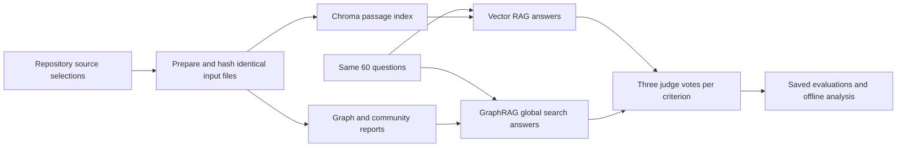
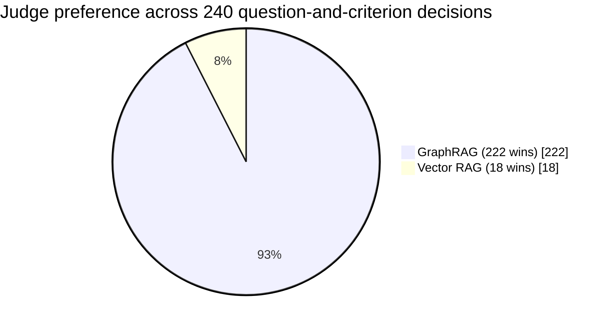

# Rousseau: Vector RAG vs. GraphRAG

[](https://github.com/Killian-Williams/Jean-Jacque-Rousseau-GraphRAG-VectorRAG-Benchmark/actions/workflows/checks.yml)

A comparison of Microsoft's GraphRAG and a vector RAG baseline for answering questions about Jean-Jacques Rousseau's political and philosophical writings.

**Takeaway:** The saved evaluation favors GraphRAG on all four criteria, while vector RAG answers substantially faster. See [Results](#results) for the figures and their limitations.

[Quick start](#quick-start) · [How it works](#how-it-works) · [Source texts](#source-texts) · [Evaluation method](#evaluation-method) · [Results](#results) · [Answer example](#answer-example) · [Artifacts](#explore-the-artifacts) · [Offline analysis](#analyze-saved-results)

## Research question

**How do these two systems compare when answering questions about themes and ideas that span multiple documents?**

Rousseau's writings were chosen because his works explore recurring themes such as freedom, rights, education, and government. This project examines whether graph-based retrieval improves generated answers and what trade-offs it introduces compared with vector RAG.

## Contribution

This project applies Microsoft's GraphRAG to selected works by Rousseau and compares it with a vector RAG baseline.

- Collected and prepared the source texts for indexing.
- Configured GraphRAG's models, text chunking, and prompts.
- Implemented the vector RAG baseline using Python, LangChain, and Chroma.
- Developed questions covering specific details and broader philosophical themes.
- Built scripts for answer generation, evaluation, and response-time analysis.
- Documented the strengths and limitations of each approach.

## How it works



This is the workflow for new controlled runs. The original indexes behind the published results have not been conclusively identified.

The benchmark uses **GraphRAG global search** for every question category. Throughout this README, GraphRAG refers to that configuration; other search methods were not evaluated.

| Stage | Vector RAG | GraphRAG |
| --- | --- | --- |
| Preparation | Splits source texts into passages and embeds them. | Splits texts, extracts entities and relationships, and builds a graph and community reports. |
| Retrieval | Finds passages similar to the question using vector search. | Uses global search over community reports generated during GraphRAG indexing. |
| Answer generation | Supplies retrieved passages to a language model. | Supplies the selected context to a language model. |

## Source texts

| Title | Translator | Source |
|---|---|---|
| *A Discourse Upon the Origin and the Foundation of the Inequality Among Mankind* | Unknown | [Project Gutenberg](https://www.gutenberg.org/ebooks/11136) |
| *The Social Contract & Discourses* | G. D. H. Cole (George Douglas Howard) | [Project Gutenberg](https://www.gutenberg.org/ebooks/46333) |
| *Emile* | Barbara Foxley (attributed; prepared-file edition unverified) | [Online Library of Liberty](https://oll.libertyfund.org/titles/rousseau-emile-or-education) |

The repository provides three prepared text files for new builds. Historical corpus equivalence is unverified: surviving local indexes contain `reveries.txt`, and the saved answers do not identify their original index snapshots. The local indexed texts also retain introductions and other editorial material. See [SOURCES.md](SOURCES.md), [the provenance audit](CORPUS_PROVENANCE.md), and [the corpus manifest](corpus-manifest.json) for verified observations and unresolved edition/preprocessing details.

## Configuration

| Setting | Vector RAG | GraphRAG |
| --- | --- | --- |
| Framework and version | LangChain with langchain_openai, langchain_chroma, and langchain_text_splitters; Chroma vector database. | Microsoft GraphRAG v3.1.2 |
| Embedding model | text-embedding-3-large | text-embedding-3-large |
| Answer-generation model | gpt-4.1-mini with temperature=0 | gpt-4.1-mini |
| Indexing / extraction model | Not used | gpt-4.1-mini for graph extraction, description summarization, and community report generation |
| Chunk size and unit | 500 characters, using RecursiveCharacterTextSplitter | 600 tokens, using the o200k_base encoding |
| Chunk overlap and unit | Configured overlap of 100 characters | 100 tokens |
| Retrieval settings | Chroma vector store at chroma_db, collection rousseau_collection. Uses similarity_search_with_score(k=5) to retrieve up to five passages. No score threshold or reranking is applied. | Global search, selected by QUERY_METHOD = "global" in benchmark/run_graphrag.py and passed to the CLI as --method global. Community level and query context limits are not explicitly set by the benchmark runner. |
| Answer instructions | PROMPT_TEMPLATE in rag_chain.py: base answers on retrieved excerpts, address the question directly, explain concepts clearly, connect ideas when supported, distinguish evidence from interpretation, and avoid unsupported claims or invented quotations and citations. Answer partially when evidence is incomplete; explicitly state insufficient information when no answer is supported. | [Global map](prompts/global_search_map_system_prompt.txt), [reduce](prompts/global_search_reduce_system_prompt.txt), and [knowledge](prompts/global_search_knowledge_system_prompt.txt) prompts. |

See [settings.yaml](settings.yaml) and the [vector answer chain](RAG%20application/rag_chain.py) for further details.

## Evaluation method

The benchmark contains 60 questions that are evenly divided into three categories:

| Category | Questions | Purpose |
| --- | --- | --- |
| local_fact_retrieval | 20 | Retrieve specific definitions, concepts, or explanations from an individual work. |
| cross_document_reasoning | 20 | Connect and compare ideas across multiple works. |
| global_sensemaking | 20 | Synthesize broad themes and relationships across Rousseau’s writings. |

Answers were compared by `gpt-4.1-mini` using the criteria in [the evaluator](benchmark/evaluate.py). Each question received three judgments per criterion. Answer order alternates deterministically across runs to reduce position bias.

| Criterion | What the evaluator assesses |
|---|---|
| Comprehensiveness | Coverage of the question's important aspects and details, without unnecessary repetition or irrelevant material. |
| Diversity | The range of relevant perspectives, concepts, connections, and insights. |
| Empowerment | How well the answer helps readers understand the topic and make informed judgments through clear explanations, reasoning, and useful supporting detail. |
| Directness | How specifically and clearly the answer addresses the question without unnecessary material. |

Each judgment records a preferred answer (or a tie) and a written explanation, rather than a numerical quality score. The three judgments are aggregated into one majority decision for each question and criterion. Failed calls do not count as votes. The judge sees the question and the two answers, without source passages or verified reference answers.

## Results

**Correction:** These figures supersede an earlier artifact set reporting 77.08% GraphRAG preference. The current set reports 92.50%, including a reversal of the directness result; the saved vector answers and judge evaluations changed. This is a corrected saved-results snapshot, not a newly controlled benchmark. See the [release notes](RELEASE_NOTES.md).



| Criterion | GraphRAG wins | Vector RAG wins |
|---|---:|---:|
| Comprehensiveness | 100.00% (60/60) | 0.00% (0/60) |
| Diversity | 100.00% (60/60) | 0.00% (0/60) |
| Empowerment | 95.00% (57/60) | 5.00% (3/60) |
| Directness | 75.00% (45/60) | 25.00% (15/60) |
| **Overall** | **92.50% (222/240)** | **7.50% (18/240)** |

Both systems returned answers for all 60 questions. The saved evaluation file contains 720 completed judgments and 13 error records, producing 240 majority decisions. Error records are excluded from voting. There were no ties or incomplete decisions. Overall percentages pool four criteria per question; they are not the percentage of questions answered correctly.

| Recorded response time | Vector RAG | GraphRAG |
|---|---:|---:|
| Mean | 6.97 s | 656.38 s (10.94 min) |
| Median | 6.78 s | 652.82 s (10.88 min) |

### Results by question category

| Measure | Vector RAG | GraphRAG |
| --- | --- | --- |
| Local fact retrieval | 6.25% (5/80) | 93.75% (75/80) |
| Cross-document reasoning | 5.00% (4/80) | 95.00% (76/80) |
| Global sensemaking | 11.25% (9/80) | 88.75% (71/80) |

Each category contains 20 questions evaluated on four criteria, giving 80 majority decisions per category.

**Interpretation:** GraphRAG was preferred on all four criteria but took approximately 94 times longer on average. Whether the extra response time is worthwhile depends on the application. Total API cost and indexing time were not measured, so financial cost-effectiveness cannot be assessed.

GraphRAG timing includes command-line subprocess startup for each question; vector RAG timing covers a direct function call. These measurements describe this run, not general performance guarantees. Judge preferences do not establish factual accuracy, citation correctness, or faithfulness to Rousseau's writings. Differences in prompts, chunking, and context budgets also limit attribution of the results solely to retrieval architecture.

See the [summary JSON](benchmark/analysis_results/summary.json), [criterion results](benchmark/analysis_results/metric_summary.csv), [category results](benchmark/analysis_results/category_summary.csv), and [latency results](benchmark/analysis_results/latency_summary.csv).

## Answer example

**Question L01:** What does Rousseau mean by the general will?

The following are opening excerpts from the saved answers, reproduced verbatim. They illustrate presentation style; they are not independently verified explanations of Rousseau.

| Vector RAG | GraphRAG — global search |
|---|---|
| Rousseau's concept of the General Will is a foundational idea in his political philosophy, particularly as articulated in his work, *The Social Contract*. The General Will represents the collective will of the citizenry aimed at the common good, transcending individual interests. It is essential to understand that the General Will is not merely the sum of individual wills (which Rousseau refers to as the "Will of All"), but rather a unified expression of the collective interest that seeks the welfare of the community as a whole. | Jean-Jacques Rousseau's concept of the *general will* is a foundational and central idea in his political philosophy, representing the collective sovereignty of the people as a unified body aimed at the common good and public interest. |
| **Recorded response time:** 9.757 s | **Recorded response time:** 705.086 s |

The full vector answer continues with further explanation. The full GraphRAG answer expands into sections on sovereignty, liberty, institutions, and private interests, with internal report references. Read both complete responses in the [vector answer file](benchmark/vector_answers.json) and [GraphRAG answer file](benchmark/graphrag_answers.json); search for `L01`.

## Explore the artifacts

| Artifact | What it contains |
|---|---|
| [Benchmark questions](benchmark/questions.json) | All 60 questions, categories, and intended scope |
| [Vector RAG answers](benchmark/vector_answers.json) | Generated responses and recorded latency |
| [GraphRAG answers](benchmark/graphrag_answers.json) | Global-search responses and recorded latency |
| [Raw judge evaluations](benchmark/evaluations.json) | Individual judgments used by the analysis |
| [Summary JSON](benchmark/analysis_results/summary.json) | Overall results, category breakdowns, latency, and methodological notes |
| [Question results](benchmark/analysis_results/question_results.csv) | Per-question, per-criterion majority outcomes |
| [Criterion summary](benchmark/analysis_results/metric_summary.csv) | Win rates by evaluation criterion |
| [Category summary](benchmark/analysis_results/category_summary.csv) | Results by question category |
| [Category and criterion summary](benchmark/analysis_results/category_metric_summary.csv) | Detailed breakdown across both dimensions |
| [Latency summary](benchmark/analysis_results/latency_summary.csv) | Mean and median response times |
| [Analysis script](benchmark/analysis.py) | Code that regenerates the summaries |

## Quick start

Use **Python 3.12** and Git. Run all commands from the **repository root**, which contains `settings.yaml`, `benchmark/`, and `scripts/`. Direct dependencies are pinned in [requirements.txt](requirements.txt); each controlled run also records the installed transitive package versions. No existing indexes are required.

### 1. Clone and install

```sh
git clone https://github.com/Killian-Williams/Jean-Jacque-Rousseau-GraphRAG-VectorRAG-Benchmark.git
cd Jean-Jacque-Rousseau-GraphRAG-VectorRAG-Benchmark
```

Windows PowerShell:

```powershell
py -3.12 -m venv .venv
.\.venv\Scripts\Activate.ps1
python -m pip install -r requirements.txt
python -m pip check
Copy-Item .env.example .env
```

macOS/Linux:

```sh
python3.12 -m venv .venv
. .venv/bin/activate
python -m pip install -r requirements.txt
python -m pip check
cp .env.example .env
```

If PowerShell blocks activation, use `.\.venv\Scripts\python.exe` in place of `python` in subsequent commands. Installation requires internet access and can take several minutes or longer, depending on downloads. The full GraphRAG dependency tree is large.

### 2. Prepare and check the corpus (no API calls)

```sh
python scripts/prepare_data.py
python scripts/prepare_data.py --check
python "RAG application/ingest.py" --dry-run
python scripts/check_repository.py
python -m unittest discover -s tests -v
```

Preparation copies the three committed selections into `input/`, normalizes UTF-8 BOMs and line endings, and writes `input/manifest.json` with SHA-256 hashes and a corpus ID. Both systems read these same files. Extra input texts are rejected. Dry-run ingestion validates and splits them without writing a database or requesting embeddings. These checks normally take seconds after installation. They establish input-byte equality, not completeness or authenticity of the source editions; see [corpus provenance](CORPUS_PROVENANCE.md).

### 3. Configure credentials and create an isolated run

For live generation, edit your local `.env`: set `OPENAI_API_KEY` for vector RAG, and `GRAPHRAG_API_KEY` for GraphRAG and judging. Both can use the same funded OpenAI key. The committed [.env.example](.env.example) contains blank credentials and the judge defaults. `.env` is ignored by Git. Do not run `graphrag init`: this repository already supplies its configuration and prompts.

```sh
python scripts/experiment.py create --run-id rousseau-001
```

This command makes **no API calls**. It creates `runs/rousseau-001/` containing copies of the source selections, prepared input, code, questions, prompts, and settings, plus `run.json`. Choose a new ID for each experiment. Published answers under `benchmark/` remain separate. The run metadata records the source commit, corpus hashes, configuration hashes, index identifiers, stage timestamps, installed packages, and output hashes as the run progresses. Keep the whole run directory when archiving results.

### 4. Build both indexes and ask a sample question (paid)

**Live testing and the new benchmark are deferred until API funding and reliable internet are available.** The commands below are the executable path for that later run; successful end-to-end live generation has not yet been verified.

```sh
python scripts/experiment.py index-vector --run-id rousseau-001 --allow-api
python scripts/experiment.py index-graph --run-id rousseau-001 --allow-api
python scripts/experiment.py sample --run-id rousseau-001 --allow-api
```

Expected outputs inside the run directory: `chroma_db/`, GraphRAG `output/` (including `documents.parquet` and community reports), and `sample-0.log` / `sample-1.log` answering “What does Rousseau mean by the general will?” Indexing time and API cost were not measured in the historical run; allow substantial time and monitor the provider's usage dashboard. Historical mean question times were about 7 seconds for vector RAG and 11 minutes for GraphRAG, with no guarantee for a new run.

### 5. Generate answers, evaluate, and analyze

```sh
python scripts/experiment.py answers --run-id rousseau-001 --allow-api
python scripts/experiment.py evaluate --run-id rousseau-001 --allow-api
python scripts/experiment.py analyze --run-id rousseau-001
```

`answers` runs all 60 questions through both systems. `evaluate` requests three judge votes for each of four criteria: 720 judgments before retries. Both stages incur API charges. The historical GraphRAG question run alone took roughly 11 hours; vector questions took roughly 7 minutes in total. Evaluation duration and total cost are unmeasured. Analysis takes seconds and makes no API calls.

Outputs are `runs/rousseau-001/benchmark/vector_answers.json`, `graphrag_answers.json`, `evaluations.json`, and `analysis_results/summary.json` plus CSV tables. Stage logs sit beside `run.json`. Each paid stage requires `--allow-api`; snapshots and completed outputs are checked before later stages. An attempted stage cannot be rerun in place: preserve failed logs and create a new run ID. Index changes also stop the run for inspection. Do not directly run the original benchmark generators at the repository root, as they write over the published filenames.

To regenerate analysis again after a completed run, use:

```sh
python -I -S runs/rousseau-001/benchmark/analysis.py
```

## Analyze saved results

You can inspect every artifact above without API credentials. To regenerate the CSV and JSON summaries, use Python 3.12 and run this command from the repository root, the directory containing `benchmark/`:

```powershell
python benchmark/analysis.py
```

The script reads the saved questions, answers, and evaluations and writes to `benchmark/analysis_results/`. It makes no API calls and requires only the Python standard library for CSV/JSON output. If `matplotlib` is installed, it also generates a chart; otherwise it skips that chart.

## Repository contents

| Path | Purpose |
| --- | --- |
| [RAG application/](RAG%20application/) | Vector RAG implementation, including ingestion and retrieval code. |
| [benchmark/](benchmark/) | Benchmark questions, answer-generation scripts, evaluation scripts, and small results files. |
| [prompts/](prompts/) | Prompts used by the GraphRAG workflow. |
| [settings.yaml](settings.yaml) | GraphRAG configuration. |
| [requirements.txt](requirements.txt) | Python dependencies and versions needed to reproduce the project. |
| [.gitignore](.gitignore) | Excludes credentials, environments, and generated artifacts. |

Generated databases, caches, logs, and full indexing outputs are excluded. They can be recreated locally.

## Automated checks

Run `python scripts/check_repository.py` to verify configured prompt paths, JSON structure, matching benchmark/question IDs, evaluation coverage, saved-summary regeneration, and release artifact fingerprints. Run `python -m unittest discover -s tests -v` to exercise the failure checks, preparation, and paid-stage guard. These commands use only Python's standard library and make no paid API calls. GitHub Actions also installs the pinned dependencies and runs corpus preparation and ingestion dry-run on Python 3.12. These checks do not establish successful live indexing or generation.

The [v1.0.0 release](https://github.com/Killian-Williams/Jean-Jacque-Rousseau-GraphRAG-VectorRAG-Benchmark/releases/tag/v1.0.0) preserves this saved-results snapshot. [Release metadata](benchmark/release-manifest.json) records artifact hashes; it does not establish the missing original index-to-answer linkage. See [release notes](RELEASE_NOTES.md).

## Limitations

- Findings from this Rousseau corpus may not generalize to other authors or domains.
- Translation choices and text preparation can affect retrieval and interpretation.
- Extracted graph relationships and generated summaries can contain errors.
- The question set may favor particular question types.
- LLM-based evaluation can favor longer or more polished answers and may miss unsupported claims.
- Different corpora, answer models, or context budgets limit conclusions about retrieval alone.
- Response times vary with API conditions, caching, and models.

## Future work

- Expand the benchmark with more questions and relevant academic literature.
- Add human review of answers and citations against source passages.
- Compare other GraphRAG search methods and hybrid retrieval approaches, such as HybridRAG.
- Measure API costs and report indexing and query costs separately.
- Evaluate newer answer-generation models under controlled conditions.
- Match context budgets or measure their effect explicitly.
- Investigate whether the LLM judge favors longer answers.
- Repeat timing measurements to assess variability.
- Document how benchmark questions were authored and validated.

## References and attribution

This project uses Microsoft's GraphRAG framework. The framework and underlying research belong to their respective authors; this repository documents their application and evaluation.

- [GraphRAG research paper](https://arxiv.org/abs/2404.16130)
- [Microsoft GraphRAG repository](https://github.com/microsoft/graphrag)
- [Retrieval-Augmented Generation research paper](https://arxiv.org/abs/2005.11401)

To cite this project, use [CITATION.cff](CITATION.cff).

## License

The project's original code is licensed under the
[Apache License 2.0](LICENSE).

The Rousseau source texts and translations are separate from the
project's original code. See [Source attribution](SOURCES.md)
for their sources and applicable notices.

## Author

Killian K. Williams

[Project write-up and portfolio](https://killianportfolio6.wordpress.com/graphrag-write-up/)
